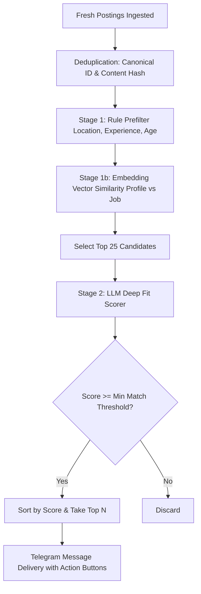

# JobRadar 📡🤖

> **Personal AI Job-Finding Telegram Bot** — Discovers fresh openings straight from company ATS portals and public APIs, performs personalized 2-stage AI matching against your uploaded resume, and delivers daily high-fit opportunities with direct apply links.
>
> ⚠️ **Strict Discovery Policy:** JobRadar only DISCOVERS and RECOMMENDS jobs. It **never** auto-applies or fills application forms on your behalf.

---

## 📑 Table of Contents
- [Architecture](#architecture)
- [How It Works](#how-it-works)
- [Telegram Commands & Interactions](#telegram-commands--interactions)
- [Hosting & Free-Tier Limits](#hosting--free-tier-limits)
- [Setup & Deployment Guide](#setup--deployment-guide)
  - [1. Bot Creation (@BotFather)](#1-bot-creation-botfather)
  - [2. MongoDB Atlas M0 Free Tier](#2-mongodb-atlas-m0-free-tier)
  - [3. Webhook Deployment (Vercel)](#3-webhook-deployment-vercel)
  - [4. Set Telegram Webhook](#4-set-telegram-webhook)
  - [5. Scheduled Daily Digest (GitHub Actions)](#5-scheduled-daily-digest-github-actions)
- [Configuration & Environment Variables](#configuration--environment-variables)
- [Two-Stage Matching Pipeline](#two-stage-matching-pipeline)
- [Testing & Dry Run](#testing--dry-run)
- [Assumptions & Limitations](#assumptions--limitations)

---

## Architecture

```
job_radar/
├── config.py              # Environment variables, pydantic settings, and credential validation
├── models.py              # Pydantic models: Job, UserProfile, Preferences, MatchResult, UserJobRecord
├── store.py               # MongoDB Atlas access layer (users, profiles, preferences, seen_jobs, user_jobs, run_logs)
├── llm.py                 # Provider-agnostic LLM interface (Gemini, OpenAI, Anthropic, Mock)
├── dedupe.py              # Two-key deduplication (canonical URL/ID + content hash)
├── jobs_pipeline.py       # Orchestration pipeline (fetch -> dedupe -> match -> notify)
├── daily_run.py           # GitHub Actions entrypoint for scheduled multi-user daily execution
├── bot/
│   ├── handlers.py        # Telegram command, file upload, text, and callback button handlers
│   ├── webhook.py         # Serverless entrypoint verifying X-Telegram-Bot-Api-Secret-Token
│   └── formatting.py      # Output templates, button keyboards, and 4096-char message splitting
├── profile/
│   └── resume_parser.py   # PDF, DOCX, TXT text extraction + LLM structured JSON parsing
├── sources/
│   ├── base.py            # Abstract JobSource with retry backoff and HTML stripping
│   ├── freehire.py        # Adapter for freehire.me /agent/jobs/search endpoint
│   ├── greenhouse.py      # Public board API for configurable Greenhouse company slugs
│   ├── lever.py           # Public postings API for configurable Lever company slugs
│   └── ashby.py           # Public job board API for configurable Ashby company slugs
└── matching/
    ├── prefilter.py       # Stage 1: Location, experience guardrails, and embedding similarity ranking
    ├── embeddings.py      # Provider-agnostic embeddings (sentence-transformers / CPU TF-IDF fallback)
    ├── llm_scorer.py      # Stage 2: Deep LLM fit evaluation (score, why_matches, missing_skills)
    └── interview_prep.py  # Tailored interview prep generator (Tech Qs, DSA, Resume, Company)
```

---

## How It Works

1. **User Onboarding:** You start the bot on Telegram with `/start` and upload your resume as a `.pdf`, `.docx`, or `.txt` file (max 5 MB).
2. **AI Resume Extraction:** The bot downloads your file via the Telegram getFile API, extracts raw text, and invokes an LLM to generate a structured JSON profile (`skills`, `experience_level`, `education`, `projects`, `preferred_roles`).
3. **Daily Autonomous Discovery:**
   - GitHub Actions runs every morning at **08:30 AM IST (03:00 UTC)**.
   - It pulls the latest job postings concurrently across **freehire**, **Greenhouse**, **Lever**, and **Ashby**.
   - Jobs are deduplicated globally via primary canonical IDs and content hashes.
4. **Two-Stage Matching Pipeline:**
   - **Stage 1 (Prefilter & Embeddings):** Drops jobs outside your target location/work mode, eliminates mismatched seniority levels, and computes cosine similarity using vector embeddings. Top 25 candidates are selected.
   - **Stage 2 (LLM Fit Scorer):** The LLM reviews the candidate profile against each top job description, producing a 0–100 score, a 2-line explanation, and missing skills.
5. **Interactive Delivery:**
   - Each job arrives as a clean, standardized Telegram message with inline buttons:
     `[Applied ✅] [Saved 💾] [Skip ⏩]`
   - Tapping buttons tracks your application lifecycle and updates `/stats`.
   - The bot records delivered IDs so **no user ever receives the same job twice**.

---

## Telegram Commands & Interactions

| Command | Description |
|---|---|
| `/start` | Welcome message and resume upload prompt |
| `/help` | Detailed command manual and usage tips |
| `/profile` | Displays your parsed skills, experience level, education, and target roles |
| `/preferences` | Interactive dashboard with inline buttons to modify roles, skills, locations, min score, and digest schedule |
| `/jobs` | Scans fresh job boards and delivers your top matches on demand |
| `/applied` | Displays a list of all jobs you marked as "Applied" with their direct application links |
| `/stats` | Shows cumulative metrics: total jobs delivered, applied, saved, and skipped |
| `/prep <company>` | Generates targeted technical interview questions, DSA patterns, and resume talking points |
| `/pause` | Temporarily halts your scheduled daily digest |
| `/resume` | Re-enables your scheduled daily digest |
| `/deleteme` | Permanently deletes your profile, preferences, and all tracking data after confirmation |

---

## Hosting & Free-Tier Limits

JobRadar runs completely on 100% free-tier services:

| Component | Platform | Free Tier Quotas & Verification |
|---|---|---|
| **Webhook Handler** | **Vercel Serverless Functions** | 100,000 function invocations/month, 10–15s execution timeout, automatic HTTPS. |
| **Daily Digest Cron** | **GitHub Actions** | 2,000 free runner minutes/month for public/private repos. 1 daily run taking ~2 min uses <60 min/month. |
| **Database** | **MongoDB Atlas (M0)** | 512 MB storage, shared RAM/vCPU, TLS encrypted, unlimited connections for low volume. |
| **LLM Inference** | **Google Gemini 1.5 Flash** | 15 RPM (Requests Per Minute), 1,500 RPD (Requests Per Day) on the free tier. |
| **Embeddings** | **Local Sentence-Transformers / TF-IDF** | Runs locally on CPU during execution, 0 API cost and 0 external token quota consumed. |
| **Job Sources** | **freehire.me + ATS Public APIs** | Free public JSON read endpoints requiring no paid plans. |

---

## Setup & Deployment Guide

### 1. Bot Creation (@BotFather)
1. Open Telegram and search for `@BotFather`.
2. Send `/newbot` and follow the prompts to choose a bot name and username (e.g. `MyJobRadarBot`).
3. Copy the HTTP API token provided by BotFather. This is your `TELEGRAM_BOT_TOKEN`.
4. Generate a random secret string for webhook validation (e.g., using `openssl rand -hex 20`). This is your `TELEGRAM_WEBHOOK_SECRET`.

### 2. MongoDB Atlas M0 Free Tier
1. Create a free account at [mongodb.com/atlas](https://www.mongodb.com/atlas).
2. Create a free **M0 Sandbox** cluster.
3. Under **Security → Database Access**, create a user with read/write access.
4. Under **Network Access**, add `0.0.0.0/0` (allow access from anywhere) so Vercel and GitHub Actions can connect.
5. Copy your connection string:
   ```
   mongodb+srv://<username>:<password>@cluster0.abcde.mongodb.net/?retryWrites=true&w=majority
   ```

### 3. Webhook Deployment (Vercel)
1. Fork or clone this repository to your GitHub account.
2. Sign in to [Vercel](https://vercel.com) and click **Add New → Project**.
3. Import your GitHub repository.
4. In the Project Settings under **Environment Variables**, add:
   - `TELEGRAM_BOT_TOKEN`: Your Telegram token from BotFather
   - `TELEGRAM_WEBHOOK_SECRET`: Your random secret token
   - `MONGODB_URI`: Your MongoDB Atlas URI
   - `MONGODB_DB_NAME`: `job_radar`
   - `LLM_PROVIDER`: `gemini` (or `openai` / `anthropic`)
   - `GEMINI_API_KEY`: Your Gemini API key
   - `ALLOWED_CHAT_IDS`: Your Telegram user ID (optional, to restrict bot usage to you)
5. Click **Deploy**. Vercel will build and assign you a production HTTPS URL (e.g., `https://jobradar-xyz.vercel.app`).

### 4. Set Telegram Webhook
Tell Telegram to route incoming messages to your Vercel function:

```bash
curl -X POST "https://api.telegram.org/bot<YOUR_TELEGRAM_BOT_TOKEN>/setWebhook" \
     -H "Content-Type: application/json" \
     -d '{
       "url": "https://your-project.vercel.app/api/index.py",
       "secret_token": "<YOUR_TELEGRAM_WEBHOOK_SECRET>"
     }'
```

Verify the webhook status anytime:
```bash
curl "https://api.telegram.org/bot<YOUR_TELEGRAM_BOT_TOKEN>/getWebhookInfo"
```

### 5. Scheduled Daily Digest (GitHub Actions)
1. In your GitHub repository, go to **Settings → Secrets and variables → Actions**.
2. Click **New repository secret** and add:
   - `TELEGRAM_BOT_TOKEN`
   - `TELEGRAM_WEBHOOK_SECRET`
   - `MONGODB_URI`
   - `MONGODB_DB_NAME` (`job_radar`)
   - `LLM_PROVIDER` (`gemini`)
   - `GEMINI_API_KEY`
   - `OWNER_CHAT_ID` (your numeric Telegram chat ID to receive run alerts)
   - `ALLOWED_CHAT_IDS`
3. Under the **Actions** tab in GitHub, the `Daily JobRadar Digest` workflow will appear.
4. You can trigger it manually at any time by selecting **Run workflow** (with an optional `dry_run` checkbox).
5. The scheduled cron `0 3 * * *` will trigger automatically every day at 03:00 UTC (08:30 AM IST).

---

## Configuration & Environment Variables

Copy `.env.example` to `.env` for local testing:

```ini
TELEGRAM_BOT_TOKEN=123456789:ABCdefGhIJKlmNoPQRsTUVwxyZ
TELEGRAM_WEBHOOK_SECRET=your_secret_random_webhook_token_here
ALLOWED_CHAT_IDS=123456789   # Optional: limits bot to specific users
OWNER_CHAT_ID=123456789      # Receives alerts if daily run fails

MONGODB_URI=mongodb+srv://...
MONGODB_DB_NAME=job_radar

LLM_PROVIDER=gemini          # 'gemini', 'openai', 'anthropic', or 'mock'
GEMINI_API_KEY=AIzaSy...

EMBEDDING_PROVIDER=local     # 'local', 'gemini', 'openai', or 'mock'
FREEHIRE_BASE_URL=https://freehire.me/api/v1

GREENHOUSE_COMPANIES=cloudflare,stripe,gitlab,automattic
LEVER_COMPANIES=postman,netflix,spotify
ASHBY_COMPANIES=retool,linear,ramp

DRY_RUN=false
```

---

## Two-Stage Matching Pipeline



---

## Testing & Dry Run

Run all unit tests locally with `pytest`:

```bash
pytest tests/ -v
```

Run a dry run of the daily ingestion pipeline (prints formatted digests to terminal without sending Telegram messages or modifying the database):

```bash
python daily_run.py --dry-run
```

---

## Assumptions & Limitations

1. **Bot Scope:** The agent strictly finds, ranks, and recommends jobs with verified direct links. It intentionally does not attempt automated form filling to prevent terms-of-service violations or account bans.
2. **ATS Company Slugs:** Greenhouse, Lever, and Ashby adapters query public job boards for configured company slugs (`GREENHOUSE_COMPANIES`, etc.). You can easily customize or add more target companies in `.env`.
3. **Resume Content Privacy:** Resumes are parsed in-memory; raw files are immediately discarded and never saved to disk. Extracted text is used solely for matching and is never written to application logs.
4. **Vercel Timeout Guard:** Resume parsing takes 2–4 seconds on average with Gemini Flash. If a slower connection or larger document exceeds serverless timeouts, the workflow can offload parsing via GitHub Actions dispatch.
